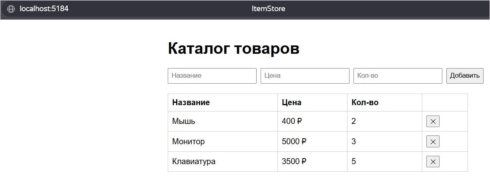
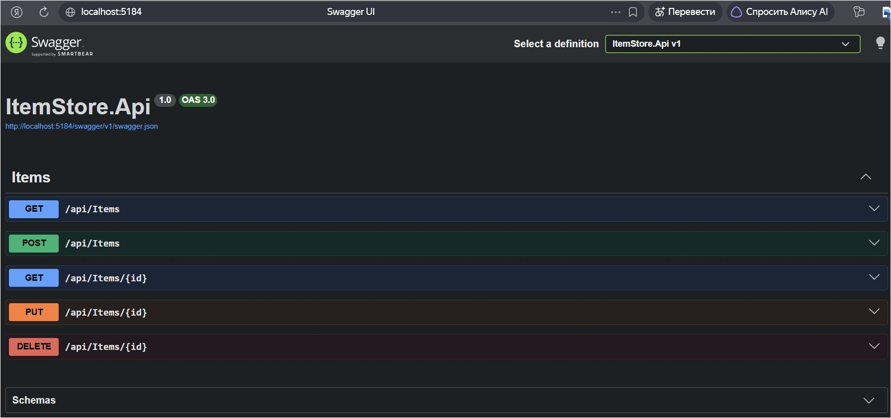

# ItemStore — REST API на ASP.NET Core

[]()
[]()
[]()

Учебный REST API: CRUD «элементов» (товары) с валидацией, миграциями EF Core
и простой веб-страницей каталога.

## Скриншоты





## Стек

- ASP.NET Core 10, EF Core
- SQLite (локальный запуск), PostgreSQL 16 (в Docker)
- Swagger UI
- Статический фронтенд: HTML/JS/CSS

## Возможности
- CRUD-операции с товарами
- Валидация входных данных
- Веб-страница каталога

## Быстрый старт (локально)

```bash
dotnet run --project src/ItemStore.Api
```

- Каталог: `http://localhost:5184/`
- Swagger: `http://localhost:5184/swagger`

База по умолчанию — SQLite, миграции применяются автоматически при старте
(`Database.Migrate()` в `Program.cs`).

## Запуск в Docker (Podman)

```bash
podman compose up --build
```

- Каталог: `http://localhost:8080/`
- Swagger: `http://localhost:8080/swagger`
- PostgreSQL поднимается сервисом `db`, данные хранятся в volume `pgdata`.

Остановить:

```bash
podman compose down
```

Данные в volume сохраняются между перезапусками.

## Конфигурация

| Переменная | Назначение |
|---|---|
| `ASPNETCORE_URLS` | Адрес, который слушает API (`http://+:8080`) |
| `ASPNETCORE_ENVIRONMENT` | `Development` включает Swagger |
| `ConnectionStrings__Default` | Строка подключения; в Docker — PostgreSQL |

## API

| Метод | Путь | Описание |
|---|---|---|
| GET | `/api/Items` | Список элементов |
| GET | `/api/Items/{id}` | Один элемент |
| POST | `/api/Items` | Создать элемент |
| PUT | `/api/Items/{id}` | Обновить элемент |
| DELETE | `/api/Items/{id}` | Удалить элемент |

## Тесты

```bash
dotnet test
```

## Структура проекта

```text
src/
  ItemStore.Api/    # REST API + статическая страница каталога
tests/
  ItemStore.Tests/  # юнит-тесты API
docs/
  screenshots/      # скриншоты для README
```

## Планы

- [ ] Пагинация списка

## Примечание

Проект выполнен в учебных целях при помощи ИИ-ассистента.
Весь код разобран и осмыслен.
